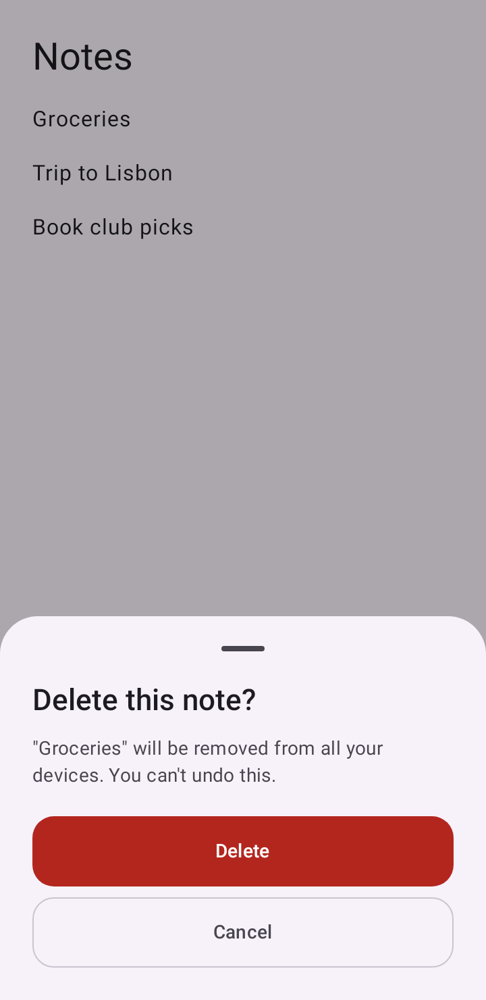
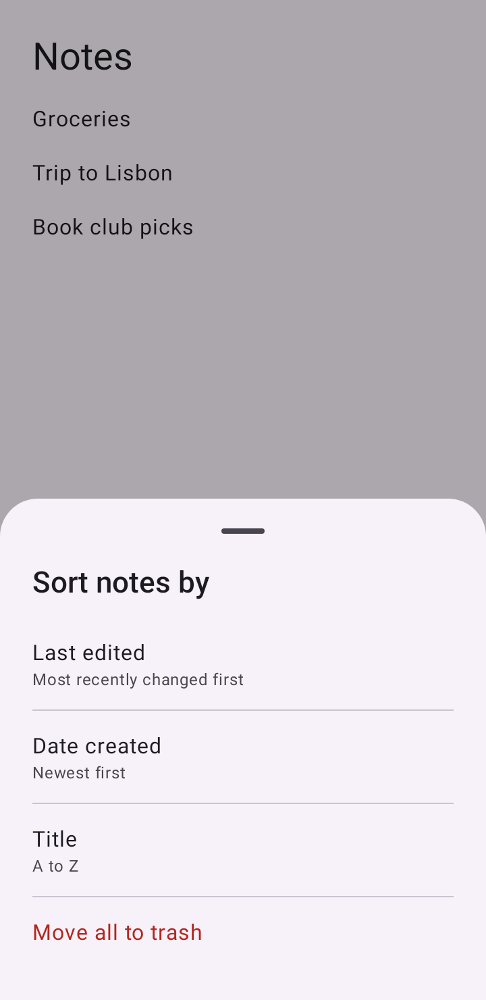
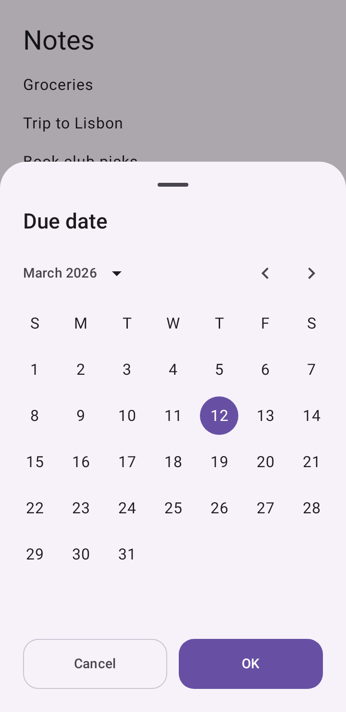
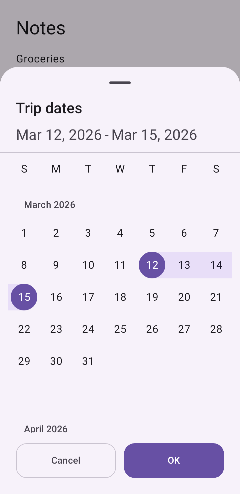
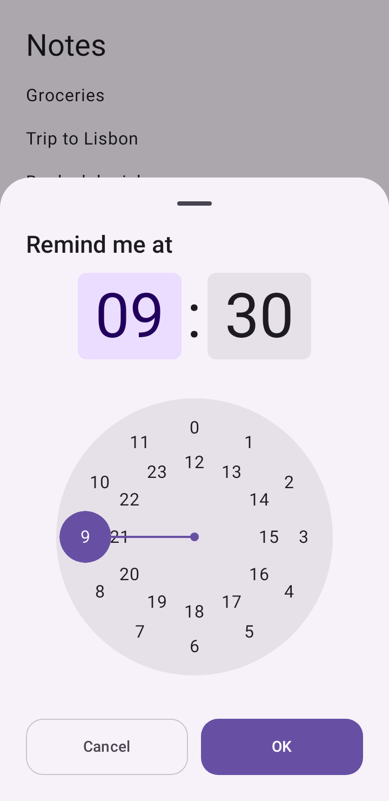
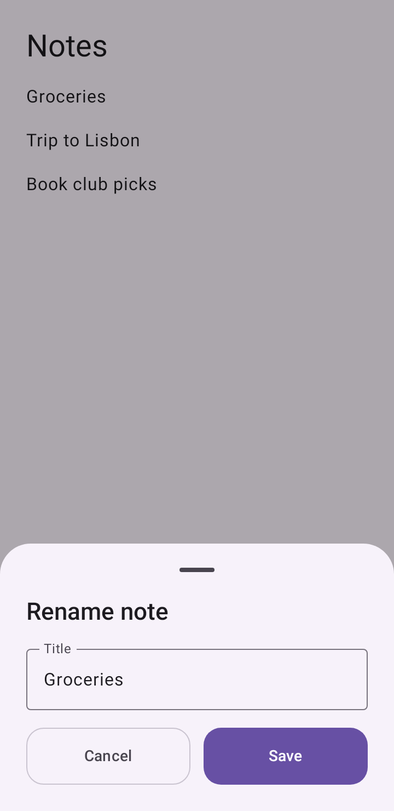
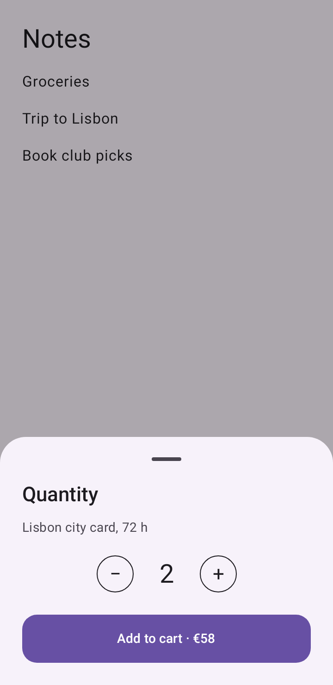

# compose-bottom-sheets

[](https://github.com/ThalzeronLabs/compose-bottom-sheets/actions/workflows/ci.yml)
[](https://jitpack.io/#ThalzeronLabs/compose-bottom-sheets)
[](LICENSE)


[](https://thalzeronlabs.github.io/compose-bottom-sheets/)

**Bottom sheets you can `await` in Jetpack Compose — confirm, choose, date, date range, time, text input, rating,
progress and your own content, one line each.**

Dialogs in the middle of the screen are awkward on tall phones. Bottom sheets sit where the thumb is, but wiring each
one by hand means a `Boolean` flag, a callback and a lot of boilerplate per question. This library turns every sheet
into a `suspend` call, the same way `SnackbarHostState` works for snackbars.

## Install

Add JitPack to your repositories (`settings.gradle.kts`):

```kotlin
dependencyResolutionManagement {
    repositories {
        google()
        mavenCentral()
        maven("https://jitpack.io")
    }
}
```

Then the one line (`app/build.gradle.kts`):

```kotlin
implementation("com.github.ThalzeronLabs:compose-bottom-sheets:v0.2.1")
```

`minSdk` 23. Built against `compileSdk` 37 and Compose BOM `2026.09.00`; the theme comes from your `MaterialTheme`.

## Quick start

**Before** — one flag, one sheet state and one callback per question:

```kotlin
var askDelete by remember { mutableStateOf(false) }
val sheetState = rememberModalBottomSheetState()
val scope = rememberCoroutineScope()

Button(onClick = { askDelete = true }) { Text("Delete") }

if (askDelete) {
    ModalBottomSheet(onDismissRequest = { askDelete = false }, sheetState = sheetState) {
        Text("Delete this note?")
        Button(onClick = {
            scope.launch { sheetState.hide() }.invokeOnCompletion {
                askDelete = false
                viewModel.delete(note)
            }
        }) { Text("Delete") }
        OutlinedButton(onClick = {
            scope.launch { sheetState.hide() }.invokeOnCompletion { askDelete = false }
        }) { Text("Cancel") }
    }
}
```

**After** — the question is a function call and the answer is its return value:

```kotlin
val sheets = remember { SheetHostState() }
val scope = rememberCoroutineScope()
SheetHost(sheets)   // once per screen

Button(onClick = {
    scope.launch {
        if (sheets.confirm("Delete this note?", "You can't undo this.", confirmLabel = "Delete", destructive = true)) {
            viewModel.delete(note)
        }
    }
}) { Text("Delete") }
```

## What's inside

| Call | Returns | Draws |
|---|---|---|
| `confirm(title, message, destructive)` | `Boolean` | two full-width buttons (red when destructive) |
| `choose(title, options)` | the option's typed value, or `null` | a tappable list with descriptions |
| `pickDate(title, initialUtcMillis)` | UTC epoch millis, or `null` | the Material 3 `DatePicker` inside a sheet |
| `pickTime(title, initial, is24Hour)` | `TimeOfDay`, or `null` | the Material 3 `TimePicker` inside a sheet |
| `pickDateRange(title, initial)` | `DateRange` (start, end, `days`), or `null` | the Material 3 `DateRangePicker` inside a sheet |
| `input(title, initial, validate)` | `String`, or `null` | a text field with live validation |
| `rate(title, message, stars)` | `Int` (1..stars), or `null` | a row of tappable stars |
| `withProgress(title, message) { … }` | whatever the block returns | a progress bar that closes itself when the block ends |
| `custom<T>(title) { … answer(value) }` | your `T`, or `null` | your own composable content |

Every call also takes an optional `accent: Color` (see [Theming](#theming)).

```kotlin
val sort = sheets.choose("Sort by", listOf(SheetOption("Newest", Sort.NEW), SheetOption("Oldest", Sort.OLD)))
val due = sheets.pickDate("Due date") ?: return
val trip = sheets.pickDateRange("Trip dates") ?: return          // trip.days == 4
val at = sheets.pickTime("Remind me at", TimeOfDay(9, 0))
val name = sheets.input("Rename", note.title, validate = { if (it.isBlank()) "Required" else null })
val stars = sheets.rate("Rate your stay", "How was Lisbon?") ?: return
```

### Progress that closes itself

`withProgress` shows the sheet, runs your block, and closes the sheet when the block returns or throws — the result
(or the exception) comes straight back to you. Set `fraction` for a determinate bar and `message` for the line under
the title; TalkBack announces message changes.

```kotlin
val urls = sheets.withProgress("Uploading", "0 of ${photos.size}") {
    photos.mapIndexed { i, photo ->
        api.upload(photo).also {
            fraction = (i + 1f) / photos.size
            message = "${i + 1} of ${photos.size}"
        }
    }
}
```

The user can't swipe it away; cancel the calling coroutine to stop the work. Opening another sheet of the same
`SheetHostState` from inside the block throws instead of waiting forever.

### Your own content, typed result

```kotlin
val quantity: Int? = sheets.custom("Quantity") {
    var count by rememberSaveable { mutableIntStateOf(1) }
    Stepper(count, onChange = { count = it })
    Button(onClick = { answer(count) }) { Text("Add to cart") }   // dismiss() returns null
}
```

The title, padding, swipe-to-dismiss, queueing and cancellation are the same as for the built-in sheets.

## Gallery

Every image below is rendered by a test ([`SheetScreenshotTest`](sheets/src/test/kotlin/com/thalzeronlabs/sheets/SheetScreenshotTest.kt))
on the JVM with Robolectric + [Roborazzi](https://github.com/takahirom/roborazzi), no emulator. CI runs
`verifyRoborazziDebug`, so a pull request that changes how a sheet looks fails until the images are re-recorded.

| `confirm` | `choose` | `pickDate` | `pickDateRange` | `pickTime` |
|---|---|---|---|---|
|  |  |  |  |  |

| `input` | `rate` (with `accent`) | `withProgress` | `custom` |
|---|---|---|---|
|  |  |  |  |

## Why suspend sheets

- **The flow reads top to bottom.** "Ask for a name, then a due date, then save" is three lines in one coroutine,
  not three flags and three callbacks spread across the composable.
- **The answer is typed.** `choose` returns your `T`, `pickTime` returns a `TimeOfDay`, a dismissal is `null`.
  No `Any` payloads, no state to reset after the sheet closes.
- **Cancellation is free.** The sheet belongs to the coroutine that asked. If the screen leaves and its scope is
  cancelled, the sheet closes with it.
- **It is testable without UI.** `SheetHostState` is plain state: a test calls `confirm(...)`, reads `current`, and
  resolves it. The 22 JVM unit tests in this repo do exactly that.
- **It's a pattern you already know.** `SnackbarHostState.showSnackbar()` works the same way; this applies it to sheets.

## Behaviour you can rely on

- **One sheet at a time.** A second request waits in line until the first is answered.
- **Cancellation-safe.** Cancel the calling coroutine (e.g. the screen leaves) and its sheet closes.
- **Swipe to dismiss = no answer.** `confirm` returns `false`, everything else returns `null`.
- **The sheet animates out before your code continues**, so the next UI change never fights the closing sheet.
- **Theming comes from your `MaterialTheme`**, with an optional accent per call.
- **Survives rotation** when the state lives in a ViewModel (below).

## Rotation, dark mode and process death

A configuration change (rotation, dark mode, language, window resize) recreates the activity. What happens to an open
sheet depends on who owns the `SheetHostState` and the coroutine that asked.

**In a ViewModel: the sheet survives.** It stays open, keeps what the user already entered (typed text, the chosen
star, the picked date, range or time, the progress) and still answers the coroutine that asked:

```kotlin
class NoteViewModel : ViewModel() {
    val sheets = SheetHostState()

    fun rename(note: Note) = viewModelScope.launch {
        val title = sheets.input("Rename note", note.title) ?: return@launch
        repository.rename(note, title)
    }
}

@Composable
fun NoteScreen(viewModel: NoteViewModel = viewModel()) {
    SheetHost(viewModel.sheets)
    // ...
}
```

**With `remember` and `rememberCoroutineScope()`: the question is cancelled.** The scope dies with the old
composition, so the sheet closes and the caller gets a `CancellationException`, like any other cancellation. That is
fine for quick, throw-away questions; use a ViewModel when losing the answer would hurt.

**After process death** (or with "Don't keep activities"), the ViewModel and the coroutine waiting for the answer are
gone too: a suspended call can't be brought back. The screen comes back without the sheet, and the next call opens a
fresh one. If a half-finished flow must survive that, save its progress yourself (e.g. in `SavedStateHandle`) and ask
again.

**Your own `custom` content** keeps its state across a configuration change if it uses `rememberSaveable` instead of
`remember`.

`SheetRecreationTest` checks all of this with a real activity recreation and a real ViewModel.

## Theming

The sheets draw with the `MaterialTheme` around `SheetHost`: colors, typography and shapes are yours (put `SheetHost`
inside your theme). To make one sheet stand out, pass an `accent`:

```kotlin
sheets.rate("Rate your stay", accent = Color(0xFFA15C00))   // stars + Submit in amber, the rest stays your theme
sheets.confirm("Publish?", accent = brandGreen)
```

The accent replaces `primary` for that sheet only (buttons, selected day, stars, focused field, progress bar) and a
soft container is derived from it for the time picker and the date range band. Text drawn **on** the accent is black or
white, whichever has the higher contrast, so it always meets WCAG AA (4.5:1). The accent is also used as text on the
sheet itself (outlined buttons, today's date), so pick one with 4.5:1 against your surface — `SheetContrastTest` shows
how to check.

## Accessibility

- **Labels.** Every tappable element has text or a content description; each star is read as "3 of 5 stars"
  (`starLabel` lets you translate it), and a `choose` option is read as one item, label and description together.
- **Touch targets.** Everything tappable is at least 48 x 48dp (buttons are 52dp tall, stars 56dp), including the
  drag handle: it is drawn as Material's 32 x 4dp bar, inside a 48 x 48dp target.
- **Focus order** follows what you see: title, content, then the buttons from left to right.
- **Live updates.** The progress message is a polite live region and the bar exposes its value; the progress sheet has
  no drag handle or close action, because it can't be dismissed.
- **Contrast.** Text meets WCAG AA in the default light and dark schemes and on any accent (see above).

`SheetAccessibilityTest` checks labels, touch targets and reading order for every sheet on the JVM, and
`SheetContrastTest` checks the color pairs. Headings and button roles are tracked in
[issue #4](https://github.com/ThalzeronLabs/compose-bottom-sheets/issues/4).

## Localization

The default labels ("Cancel", "OK", "Submit", "of 5 stars", …) are in English. Every label a sheet shows can be
passed in (`confirmLabel`, `dismissLabel`, `starLabel`, the titles and messages), so you can hand in your own
`stringResource(...)`. Built-in translations through Android string resources are tracked in
[issue #5](https://github.com/ThalzeronLabs/compose-bottom-sheets/issues/5).

## Sample app

[`sample/`](sample/src/main/kotlin/com/thalzeronlabs/sheets/sample/MainActivity.kt) is a one-screen app with a button
for every sheet; the answer of the last one is shown at the top. Install it on a device or emulator:

```bash
./gradlew :sample:installDebug
```

It builds against the library in this repository. With `-PsheetsVersion=v0.2.1` it uses the artifact JitPack serves
instead, exactly like your app would; the [Consumer check](.github/workflows/consumer.yml) workflow does that after
every release and once a week.

## Tests

```bash
./gradlew :sheets:verifyRoborazziDebug
```

That runs 61 tests on the JVM, no emulator:

| Test class | What it covers |
|---|---|
| `SheetHostStateTest` (22) | the request queue, answers, dismissals, cancellation, progress and custom sheets |
| `SheetAccessibilityTest` (9) | one per sheet: labels, 48dp touch targets, reading order, roles, live regions |
| `SheetContrastTest` (4) | WCAG contrast of the color pairs, light and dark, with and without accents |
| `SheetRecreationTest` (10) | rotation and process death: state kept in each sheet, the two ownership patterns |
| `SheetHostTest` (4) | real taps on rendered sheets: queueing, progress closing itself, custom and rating answers |
| `SheetThemeTest` (3) | the app's `MaterialTheme` is used, and an accent overrides it for one sheet |
| `SheetScreenshotTest` (9) | renders every sheet and compares it with `docs/screenshots/` |

After an intentional UI change, re-record the images with `./gradlew :sheets:recordRoborazziDebug`.

## Contributing

Issues labelled [good first issue](https://github.com/ThalzeronLabs/compose-bottom-sheets/labels/good%20first%20issue)
are scoped to a single afternoon. See [CONTRIBUTING.md](CONTRIBUTING.md) and the [changelog](CHANGELOG.md).

## License

Apache-2.0 © Esdras Souza (Thalzeron Labs).
